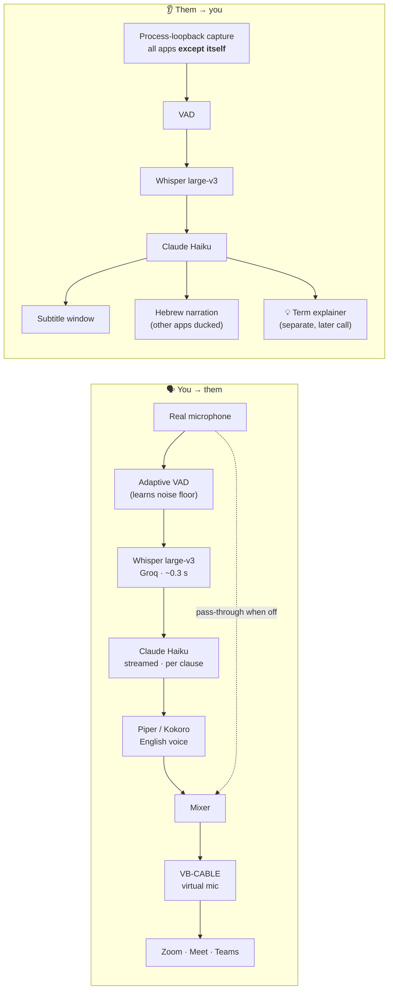

<div align="center">

# 🎙️ Live Translator

### Real-time, two-way Hebrew ⇄ English voice translation for any app on Windows

Speak Hebrew, and the other side hears natural English. They speak English, and you read and hear Hebrew.<br>
It works in Zoom, Google Meet, Teams, the browser, or a recorded lecture, with **no plugins and no app changes**.


</div>

---

## ✨ What it does

| | Feature | How it feels |
|---|---|---|
| 🗣️ | **Speak Hebrew → they hear English** | A natural English voice goes into any call through a virtual microphone. Your own Hebrew is muted. |
| 📝 | **They speak English → Hebrew subtitles** | An always-on-top subtitle window, plus optional **Hebrew narration**, with the call turned down to 30% underneath. |
| ✍️ | **Polish mode** | Turns hesitant speech ("um… I worked on, on backend stuff…") into clean, professional English. It never adds facts. |
| 💡 | **Term explanations** | After a line is translated, hard jargon gets a short Hebrew explanation, based on what *you* already know. |
| 📚 | **Personal vocabulary** | Your names, companies and tech terms are recognized and translated exactly as you want. |
| 🔒 | **Graceful by design** | Runs in the system tray. If the cloud is unreachable it works fully offline, and it never leaves you with a silent mic. |

Every feature has its own global hotkey (`Ctrl+Alt+Y / P / H / E / S`) and a checkbox in the tray menu.

---

## ⚡ Performance: measured, not guessed

Every number below was measured **end to end through the real virtual audio cable**. A test plays speech, records exactly what Zoom would receive, and transcribes it back ([`tools/e2e_speak_test.py`](tools/e2e_speak_test.py), [`tools/e2e_narrate_test.py`](tools/e2e_narrate_test.py)).

| Stage of the project | Hebrew → English voice | English → Hebrew subtitle |
|---|:---:|:---:|
| v1: fully local (Whisper + NLLB, CPU only) | 11–17 s ⚠️ backlog grew | 1–2 s |
| + Groq Whisper large-v3 + Claude Haiku | 1.4–2.9 s | 1.8–2.1 s |
| **+ streaming, kept-alive connections, no JSON schema** | **1.2–2.0 s** | **1.1–1.5 s** |

**Where the last second went:**

| Change | Saved |
|---|---|
| Plain-text output instead of a JSON schema (with a safe output guard) | **−0.55 s** per line |
| SSE streaming: the voice starts on the **first clause**, not the full sentence | −0.3 s on long lines |
| One kept-alive HTTPS connection per service | −0.1 to 0.3 s |
| Whisper single-pass decoding (no temperature fallback) | worst case 23 s → 0.3 s |

A real sample from the test, Hebrew mixed with English tech terms the way Israelis actually talk:

| Said (Hebrew) | The other side heard |
|---|---|
| עשיתי ריפקטור לכל הבקאנד | *I did a refactor of the entire backend.* |
| העברתי את המיקרוסרוויסים לקוברנטיס | *I moved the microservices to Kubernetes.* |
| היום אני בונה AI Agents עם LLM | *Today I'm building AI Agents with an LLM.* |

---

## 🏗️ Architecture



Each stage runs on its own thread with bounded queues. If recognition falls behind, queued phrases are merged into one pass so the delay can't snowball. Every cloud stage has a local fallback: **faster-whisper**, **NLLB-200** (CTranslate2, int8) and **Piper**.

---

## 🧠 Engineering highlights

Real problems found on a real machine, and how they were solved:

| Problem | Solution |
|---|---|
| **The app heard its own Hebrew narration** and translated it back ("שלום → Hello → שלום…") | Windows 11 **process-loopback** capture (`ActivateAudioInterfaceAsync`, exclude own process tree), implemented with raw COM in Python. Measured leakage: 0.0003, which is the noise floor. |
| **Windows Smart App Control** blocked unsigned DLLs (`sentencepiece`, and `jiter` inside the Anthropic SDK) | Wrote a pure-Python **SentencePiece protobuf parser** that rebuilds the tokenizer with HF `tokenizers`, and called the Claude API over raw HTTP/SSE. No policy was bypassed. |
| **Global hotkeys silently died** under CPU load (Windows drops slow low-level hooks) | Switched from a keyboard hook to Win32 `RegisterHotKey`. |
| **The laptop mic is very quiet** (idle RMS 0.0003) and a fixed VAD threshold missed most speech | **Adaptive VAD** that tracks the room's noise floor, with hysteresis inside phrases. |
| **The model "thought aloud"** into the live voice ("Wait, let me correct that…") | Per-clause **output guard**: first line only, meta-phrase detection, and English words that weren't spoken are rejected. |
| **A network content filter** (Netspark) intercepted TLS and returned HTML block pages | Trust the Windows certificate store (`truststore`), detect block pages, notify the user once, fall back to local, retry every 5 minutes. |
| **Native libraries failed on a Hebrew Windows username** (`C:\Users\פרוינד`) | Pass 8.3 short paths to espeak-ng, and feed Kokoro phonemes directly. |
| **A crash could leave Windows with a silent mic** (default = virtual cable) | A **guard process** restores the real mic and app volumes however the app ends, plus a sign-in check. |
| **Narration needs Zoom quieter, but never left quiet** | Per-app volume ducking with originals **persisted to disk before** lowering, restored on exit, crash or next start. |

---

## 🧰 Tech stack

**Speech:** Whisper large-v3 (Groq) · faster-whisper (local)<br>
**Translation:** Claude Haiku 5.5 (streaming, context-aware, glossary) · NLLB-200 600M via CTranslate2 (local)<br>
**Voice:** Piper (English & Hebrew) · Kokoro-82M (ONNX)<br>
**Audio:** WASAPI process loopback · VB-CABLE · soundcard · pycaw<br>
**App:** Python 3.14 · Tkinter (RTL subtitle overlay) · pystray · Win32 via ctypes/comtypes

---

## 🚀 Quick start

```bash
git clone https://github.com/chanafroind-sys/live-translator.git
```

1. Double-click **`start.bat`**. The first run installs everything and downloads the local models.
2. Install **[VB-CABLE](https://vb-audio.com/Cable/)** (a free virtual microphone).
3. Optional, for the fast cloud path: set `ANTHROPIC_API_KEY` and `GROQ_API_KEY`. Without them, everything runs offline.

| Hotkey | Action |
|---|---|
| `Ctrl+Alt+Y` | Translate **my** speech to English |
| `Ctrl+Alt+P` | Polish mode (cleaner English, same meaning) |
| `Ctrl+Alt+H` | Hebrew narration of what **they** say |
| `Ctrl+Alt+E` | Explain hard terms |
| `Ctrl+Alt+S` | Show / hide subtitles |

📖 **Full user guide (Hebrew):** [docs/GUIDE.he.md](docs/GUIDE.he.md) · 🏛️ **Design notes:** [docs/ARCHITECTURE.md](docs/ARCHITECTURE.md) · 🗺️ **Roadmap:** [docs/ROADMAP.md](docs/ROADMAP.md)

---

## 📁 Project structure

```
livetranslator/
├── app.py               orchestration, subtitle pipeline, file-based test modes
├── speak.py             your mic → English voice → virtual mic (mixer, pass-through)
├── narrate.py           Hebrew narration + per-app volume ducking (crash-safe)
├── process_loopback.py  capture every app except this one (WASAPI, raw COM)
├── cloud_asr.py         Groq Whisper with noise / hallucination filtering
├── claude_translate.py  streamed, context-aware translation + output guard + polish mode
├── explain.py           personalised term explanations
├── engines.py           local Whisper / NLLB / Piper / Kokoro fallbacks
├── net.py               kept-alive HTTPS, Windows trust store, content-filter detection
├── guard.py             never leave the PC with a silent microphone
├── hotkeys.py           Win32 RegisterHotKey
├── vocabulary.py        personal terms → ASR hints + translation glossary
└── ui.py / tray.py      RTL subtitle overlay and system-tray menu
tools/                   end-to-end tests through the real audio devices, setup scripts
```

---

<div align="center">

Built by **[@chanafroind-sys](https://github.com/chanafroind-sys)** · AI-assisted development with Claude Code

<sub>Model licenses: Whisper (MIT) · NLLB-200 (CC-BY-NC 4.0) · Piper voices (per voice) · Kokoro-82M (Apache 2.0)</sub>

</div>
