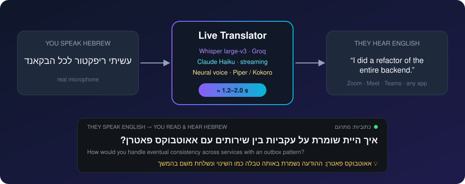
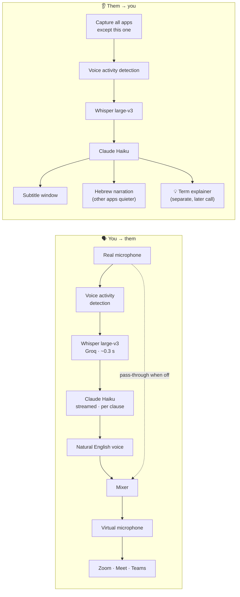

<div align="center">

# 🎙️ Live Translator

### Real-time, two-way Hebrew ⇄ English voice translation for any app on Windows

Speak Hebrew, and the other side hears natural English. They speak English, and you read and hear Hebrew.<br>
It works in Zoom, Google Meet, Teams, the browser, or a recorded lecture, with **no plugins and no app changes**.




</div>

---

## 💡 The idea

Most translation tools live **inside** one app: a Zoom add-on, a browser extension, a captioning service. I wanted the opposite: a translator that sits **between me and my computer's microphone and speakers**, so it works in *every* app at once, including the ones that don't let you install anything.

From there, every feature came from asking *"what would make a real conversation feel natural?"*

| # | Product decision | Why |
|:-:|---|---|
| 1 | **Live on the microphone and speakers, not inside an app** | One tool for Zoom, Meet, Teams, browser-based tools, recorded lessons and videos. Nothing to install in the app. |
| 2 | **Two independent directions, each with its own switch** | Sometimes I only need to *understand* them, sometimes only to *be understood*. Each direction has its own hotkey (`Ctrl+Alt+Y`, `Ctrl+Alt+H`). |
| 3 | **Original quiet, translation loud** | Hearing the real voice underneath keeps tone and timing; the translation on top carries the meaning. When I hear Hebrew narration, the other apps are turned down to 30%. |
| 4 | **They hear only the translation** | While translating, my Hebrew is muted, so the other side hears one clean English voice and not two languages over each other. |
| 5 | **Cloud *or* local, by situation** | The cloud is fast and accurate; local works with no internet, on a filtered network, or when privacy matters. The app chooses automatically and says when it switched. |
| 6 | **Invisible until needed** | It lives in the system tray, not in a window that gets in the way. Subtitles appear only on demand, and nothing is transcribed while they're hidden. |
| 7 | **Speed first** | In conversation, a late translation is a useless one. I chose the fast cloud stack (Groq for recognition, Claude Haiku for translation) and a fast natural voice, and the target became "about one second". |
| 8 | **A natural female voice** | The other side should hear a person, not a robot. |
| 9 | **My own vocabulary** | Israelis mix English tech words into Hebrew ("עשיתי דיפלוי לפרודקשן"). A personal terms file makes sure *my* words, names and companies come out right. |
| 10 | **"Polish" mode on a hotkey** | When I want to sound my best, the same meaning comes out in cleaner, professional English, without false starts or "um". It never adds anything I didn't say. |
| 11 | **Explanations of hard terms, after the translation** | If they use jargon I don't know, I get a short Hebrew explanation tailored to what *I* already know. It arrives *after* the translation, so it never delays what they actually said. |
| 12 | **Documented and measured** | Every claim about speed is measured end to end, and the project is fully documented for whoever picks it up next. |

---

## ✨ What it does

| | Feature | How it feels |
|---|---|---|
| 🗣️ | **Speak Hebrew → they hear English** | A natural English voice goes into any call through a virtual microphone. |
| 📝 | **They speak English → Hebrew subtitles** | An always-on-top subtitle window, plus optional **Hebrew narration** over a quieter call. |
| ✍️ | **Polish mode** | *"אני בעצם, אממ, עבדתי שם על, על הרבה דברים של בקאנד"* → *"I actually worked on a lot of backend things there."* |
| 💡 | **Term explanations** | *"…eventual consistency with an outbox pattern?"* → 💡 a short Hebrew explanation of each term. |
| 📚 | **Personal vocabulary** | Names, companies and tech terms recognized and translated exactly as you want. |
| 🔒 | **Works anywhere** | Falls back to fully offline processing, and always restores your real microphone when it closes. |

---

## ⚡ Performance: measured, not guessed

Every number below was measured **end to end through the real virtual audio cable**. A test plays speech, records exactly what Zoom would receive, and transcribes it back ([`tools/e2e_speak_test.py`](tools/e2e_speak_test.py), [`tools/e2e_narrate_test.py`](tools/e2e_narrate_test.py)).

| Version | Hebrew → English voice | English → Hebrew subtitle |
|---|:---:|:---:|
| v1: fully local, CPU only | 11–17 s | 1–2 s |
| v2: cloud recognition and translation | 1.4–2.9 s | 1.8–2.1 s |
| **v3: streaming + speed tuning** | **1.2–2.0 s** | **1.1–1.5 s** |

**What made v3 faster:**

| Optimization | Saved |
|---|---|
| Plain-text model output instead of a structured JSON format | **−0.55 s** per line |
| Streaming: the voice starts on the **first clause**, not the whole sentence | −0.3 s on long lines |
| One kept-alive HTTPS connection per service | −0.1 to 0.3 s |
| Polish mode | ±0 s: same call, different instructions (0.77 s vs 0.84 s) |

A real sample from the test, Hebrew mixed with English tech terms:

| Said (Hebrew) | The other side heard |
|---|---|
| עשיתי ריפקטור לכל הבקאנד | *I did a refactor of the entire backend.* |
| העברתי את המיקרוסרוויסים לקוברנטיס | *I moved the microservices to Kubernetes.* |
| היום אני בונה AI Agents עם LLM | *Today I'm building AI Agents with an LLM.* |

---

## 🏗️ Architecture



Every cloud stage has a local fallback: **faster-whisper**, **NLLB-200** (CTranslate2, int8) and **Piper**.

### Under the hood

A few of the more interesting technical pieces:

- **Hearing everything except itself:** so the app never re-translates its own Hebrew narration, it records the PC with Windows 11 *process loopback*, which captures all apps except its own process (raw WASAPI/COM from Python).
- **Clause-level streaming:** the translation is streamed and spoken clause by clause, so the voice starts before the sentence is finished.
- **Personalized explanations:** a separate model call, judged against a short "what I already know" profile, runs only after the translation is delivered.
- **Locked-down Windows:** the machine's Smart App Control blocks unsigned native libraries, so the project includes a pure-Python SentencePiece tokenizer reader and calls the Claude API over raw HTTP/SSE.

More in [docs/ARCHITECTURE.md](docs/ARCHITECTURE.md).

---

## 🧰 Tech stack

**Speech:** Whisper large-v3 (Groq) · faster-whisper (local)<br>
**Translation:** Claude Haiku 5.5 (streaming, context-aware, glossary) · NLLB-200 600M via CTranslate2 (local)<br>
**Voice:** Piper (English & Hebrew) · Kokoro-82M (ONNX)<br>
**Audio:** WASAPI process loopback · VB-CABLE · soundcard · pycaw<br>
**App:** Python 3.14 · Tkinter (RTL subtitle overlay) · pystray · Win32 via ctypes/comtypes

---

## 🚀 Quick start

```bash
git clone https://github.com/chanafroind-sys/live-translator.git
```

1. Double-click **`start.bat`**. The first run installs everything and downloads the local models.
2. Install **[VB-CABLE](https://vb-audio.com/Cable/)** (a free virtual microphone).
3. Optional, for the fast cloud path: set `ANTHROPIC_API_KEY` and `GROQ_API_KEY`. Without them, everything runs offline.

| Hotkey | Action |
|---|---|
| `Ctrl+Alt+Y` | Translate **my** speech to English |
| `Ctrl+Alt+P` | Polish mode (cleaner English, same meaning) |
| `Ctrl+Alt+H` | Hebrew narration of what **they** say |
| `Ctrl+Alt+E` | Explain hard terms |
| `Ctrl+Alt+S` | Show / hide subtitles |

📖 **Full user guide (Hebrew):** [docs/GUIDE.he.md](docs/GUIDE.he.md) · 🏛️ **Design notes:** [docs/ARCHITECTURE.md](docs/ARCHITECTURE.md) · 🗺️ **Roadmap:** [docs/ROADMAP.md](docs/ROADMAP.md)

---

## 📁 Project structure

```
livetranslator/
├── app.py               orchestration, subtitle pipeline, file-based test modes
├── speak.py             your mic → English voice → virtual mic (mixer, pass-through)
├── narrate.py           Hebrew narration + other apps turned down (restored on exit)
├── process_loopback.py  capture every app except this one (WASAPI, raw COM)
├── cloud_asr.py         Groq Whisper with noise filtering
├── claude_translate.py  streamed, context-aware translation + polish mode
├── explain.py           personalized term explanations
├── engines.py           local Whisper / NLLB / Piper / Kokoro fallbacks
├── net.py               kept-alive HTTPS, cloud → local switching
├── guard.py             always restores the real microphone
├── hotkeys.py           global hotkeys
├── vocabulary.py        personal terms → recognition hints + translation glossary
└── ui.py / tray.py      RTL subtitle overlay and system-tray menu
tools/                   end-to-end tests through the real audio devices, setup scripts
```

---

<div align="center">

**Product concept, features and direction:** [@chanafroind-sys](https://github.com/chanafroind-sys)<br>
Implemented with AI-assisted development (Claude Code)

<sub>Model licenses: Whisper (MIT) · NLLB-200 (CC-BY-NC 4.0) · Piper voices (per voice) · Kokoro-82M (Apache 2.0)</sub>

</div>
